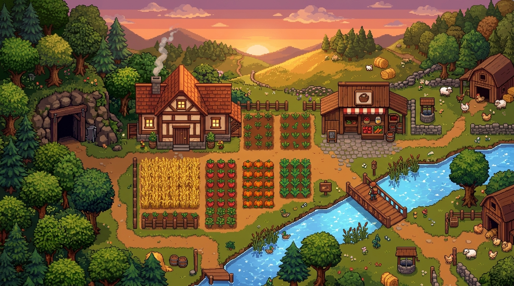

# Sonnental Hof

**Gemütliches 2D-Pixel-Art-Bauernhofspiel mit Dorfleben, Waldmine, Manufaktur, Freizeitpark und kompletter Offline-Speicherung**

`Beta 1.1` · **Entwickler:** `w33derlich` · **Plattformen:** Windows 10/11 (`.exe`), Linux / CachyOS (`.tar.gz`), Web-Browser · **Speicherung:** 100 % lokal (`.json` + Auto-Save)

---

## Downloads für Windows & Linux

Lade dir hier direkt die fertigen, eigenständigen Desktop-Versionen herunter (100 % offline spielbar ohne Online-Zwang):

- **[Windows 10/11 Setup (.exe herunterladen)](https://github.com/gnzR/Sonnentalhof/releases/latest/download/Sonnental-Hof-Setup-Beta-1.1-win-x64.exe)** — Installiert sauber pro Benutzer (ohne Admin-Zwang) mit Startmenü-Verknüpfung.
- **[Linux / CachyOS (.tar.gz herunterladen)](https://github.com/gnzR/Sonnentalhof/releases/latest/download/Sonnental-Hof-Beta-1.1-linux-x64.tar.gz)** — Kompakter Archiv-Client für Arch Linux, CachyOS & Debian/Ubuntu.
- **[SHA-256 Prüfsummen (.txt)](https://github.com/gnzR/Sonnentalhof/releases/latest/download/SHA256SUMS.txt)**

---

## Spielbeschreibung

In **Sonnental Hof** übernimmst du ein ruhiges Stück Land im Sonnental und baust es Schritt für Schritt zu einem blühenden Selbstversorger-Hof aus — ganz ohne Online-Zwang, Accounts oder Mikrotransaktionen.

Zwischen **Level 1 und 249** erwarten dich wechselnde Jahreszeiten, dynamisches Wetter, liebevoll gepixelte Gebäude und eine stetig wachsende Spielwelt rund um deinen Hof:

### Zentrale Spielinhalte
- **Ackerbau, Pilzzucht & Viehzucht:** Lege Beete an, baue Feldfrüchte, Beeren, Bäume und Pilze an, halte Hoftiere und verarbeite Rohstoffe in deiner Manufaktur zu hochwertigen Handwerksprodukten.
- **4-Etagen-Bauernhaus & Hofladen:** Erweitere dein Wohnhaus stufenweise auf bis zu vier Stockwerke und betreibe deinen eigenen Hofladen mit bis zu 50 täglichen Besuchern.
- **Nördliches Sonnental-Dorf & Schwarzes Brett:** Besuche 30 individuell gestaltete Wohnhäuser mit ihren Bewohnern, liefere Dorf-Aufträge am Schwarzen Brett ab (+48 % Lieferbonus & Dorfruf) und knüpfe ab Level 80 tiefere Beziehungen im Romantik-System.
- **Alte Waldmine & Kristallhöhle:** Schürfe 6 verschiedene Erze, entdecke 6 seltene Höhlen-Relikte, verbessere deine Spitzhacke und schmiede Kupfer-/Mondstein-Sprinkler sowie Leuchtdeko.
- **Fluss & Angelsystem:** Ab Hof-Level 15 wirfst du am Flussufer und an Stegen die Angel aus und steigerst deinen eigenen Angel-Skill.
- **Winter-Gewächshaus & saisonale Feste:** Schütze Pflanzen im Winter durch frostfreie Wärmezonen (+25 % Tempo), empfange am 1. Wintertag abends den Weihnachtsmann und feiere am 2. Wintertag das Silvester-Feuerwerk.
- **Freizeitpark-Ausbau & Endgame (Level 200–249):** Schalte ab den höheren Hofstufen eigene Park-Attraktionen frei und meistere im späten Endgame (Level 200–249) häufigere Unwetter- und Krisenereignisse mit gezielten Schutz- und Gegenmaßnahmen.
- **Tierischer Hof-Helfer & Erntehelfer:** Wähle zum Start zwischen Schwein (*Grunzi*), Hund (*Bello*), Katze (*Minka*) oder Alien (*Zirp*), levle deinen Begleiter auf und stelle automatische Erntehelfer ein.

---

## Grafik & Atmosphäre

- **Eigener 2D-Pixel-Art-Renderer:** Handgeschriebene Pixel-Sprites auf HTML5 Canvas 2D mit wählbarer Render-Auflösung (`720p`, `1080p`, `2160p 4K`).
- **Grafik-Profil „Hoch“ & „Standard“:** In den Optionen umschaltbar zwischen ressourcenschonendem Klassik-Modus und erweitertem Profil mit:
  - Tageszeit- und wetterabhängigen Sonnenschatten
  - Echten Nachtlicht-Aussparungen an Laternen, Fenstern, Hofladen & Wintergarten
  - Automatischen Boden-Übergängen (Auto-Tiling) für Ackerbeete und Wege
  - Animierten Regenpfützen, Schilf & Flussglitzern
  - Windabhängigem Wiegen von Pflanzen & Bäumen, Kamin-/Ofenrauch und Aktionspartikeln
- **Eigener MIDI-Synthesizer:** 12 ruhige Hintergrundstücke und passende Soundeffekte werden komplett lokal über die Web Audio API erzeugt.

---

## Steuerung & Speicherstände

| Taste / Aktion | Funktion |
| --- | --- |
| `WASD` / `Pfeiltasten` | Spielfigur bewegen |
| `Linksklick` | Mit gewähltem Werkzeug auf Feld, Wasser oder Objekt wirken |
| `Rechtsklick + Ziehen` | Kamera frei über die Weltkarte verschieben |
| `1` – `6`, `9` | Werkzeuge (Hand/Ernte, Acker, Gießen, Düngen, Säen, Räumen, Bau) |
| `B` / `N` / `E` / `P` / `O` | Bauernmarkt, Nachbarschaft, Saison-Events, Avatar, Optionen |
| `M` | Hintergrundmusik an / aus |

Alle Shortcuts lassen sich im Spiel unter **Optionen → Tastatur-Shortcuts** frei anpassen. Spielstände werden alle 15 Minuten automatisch gesichert und können jederzeit als `.json`-Datei exportiert oder importiert werden.

---

## Verwendete Programme, Frameworks & Bibliotheken

### Laufzeit & UI
- **React 19** (`react`, `react-dom`) — Komponenten-Architektur, Menüs, HUD & Spielzustandsverwaltung
- **TypeScript 7** — Durchgängige Typisierung für Spielsysteme, Kataloge, Savegames und Renderer
- **HTML5 Canvas 2D** — Eigener Pixel-Art-Renderer, Kamera, Partikel-Queue, Auto-Tiling & Offscreen-Lichtmaske
- **Web Audio API** — Integrierter polyphoner MIDI-Synthesizer und prozedurale Soundeffekte
- **Tailwind CSS 4** (`@tailwindcss/vite`) — Design-System und responsive Oberflächengestaltung
- **Lucide React** (`lucide-react`) — Vektor-Icons für Werkzeuge, Menüs und Aktionsleisten
- **Motion** (`motion`) — UI-Übergänge und Animationen

### Build, Entwicklung & Server
- **Node.js** & **Vite 8** (`vite`, `@vitejs/plugin-react`) — Modul-Bundler und Produktions-Builds
- **tsx** & **esbuild** — Schnelle TypeScript-Ausführung und Build-Skripte
- **Express 4** (`express`) — Lokaler Entwicklungs- und Vorschau-Server inklusive Chunk-Download-Endpunkten

### Desktop-Client & Paketierung
- **Electron 45** (`electron`) — Eigenständige Offline-Desktop-Laufzeitumgebung für Linux & Windows
- **electron-builder 26** (`electron-builder`, `app-builder-lib`) — Paketierung als Linux-`.tar.gz`-Archiv (z. B. für CachyOS / Arch) sowie Windows-10/11-NSIS-Installer (`.exe`)
